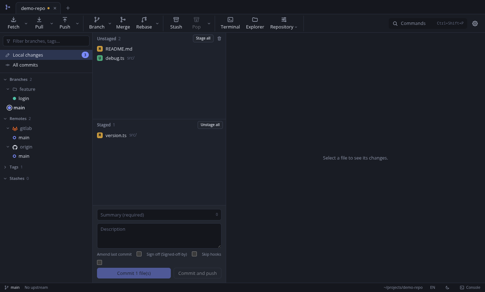

# Gitora

**English** | [Español](README.md)

Graphical Git client for Windows, macOS and Linux. It uses the `git` installed on your system, so your hooks, SSH keys, GPG and credential managers work exactly as they do in the terminal.



Usage, architecture and code documentation lives in [`docs/en/`](docs/en/README.md) ([Español](docs/README.md)).

## Requirements

- Git 2.30 or later on the `PATH`.
- To build from source: Node.js 20 or later and npm.
- Optional: `git-lfs` (Git LFS) and `openssh` (SSH remotes).

On Arch and derivatives: `sudo pacman -S git`.

## Download

Published installers are on [Releases](https://github.com/malpor23/gitora/releases). If your system has none, download the source and build the installer (see below).

```bash
git clone https://github.com/malpor23/gitora.git gitora
cd gitora
npm install
```

## Install

Build the installer with the command for your system. Files are written to the `release/` folder.

### Arch Linux and derivatives

Download the `.pacman` from [Releases](https://github.com/Malpor23/gitora/releases) and install it with `sudo pacman -U gitora-*.pacman`. To build it yourself:

```bash
npm run dist:arch
sudo pacman -U release/gitora-0.1.2.pacman
```

You can also use the bundled `PKGBUILD`:

```bash
cd packaging/arch
makepkg -si
```

### Other Linux distributions

```bash
npm run dist:linux
```

Produces `AppImage`, `.deb`, `.rpm` and `.tar.gz`. For the AppImage, make it executable and run it:

```bash
chmod +x release/Gitora-*.AppImage
./release/Gitora-*.AppImage
```

### Windows

Run on Windows (building it from Linux needs extra setup):

```bash
npm run dist:win
```

Produces an NSIS installer (Spanish and English) and a portable build in `release/`.

### macOS

Download the `.dmg` from [Releases](https://github.com/Malpor23/gitora/releases) (one for Apple Silicon, `arm64`, and one for Intel, `x64`), open it and drag Gitora to Applications. It requires macOS 13 or later. To build it yourself, on a Mac:

```bash
npm run dist:mac
```

Produces a `.dmg` and a `.zip` per architecture in `release/`. You need `git`: install the command line tools with `xcode-select --install` or use Homebrew (`brew install git`).

The app is **not notarized** (there is no Apple Developer account): it is ad-hoc signed, so macOS warns the first time. Open it with right click, **Open**, or remove the quarantine flag:

```bash
xattr -dr com.apple.quarantine /Applications/Gitora.app
```

> The macOS installers are built in CI and have not been tested on a real Mac.

## Run without installing

```bash
npm start
```

Compiles the main process, starts Angular in dev mode and opens Electron. To try the UI in a browser, see [docs/en/development.md](docs/en/development.md).

## Getting started

1. Open the app and choose **Open local repository**, **Clone repository** or **Create new repository**.
2. To clone private repositories over HTTPS, add an account under **Settings, Accounts** (token, username and password, SSH key or OAuth).
3. Press `Ctrl+Shift+P` to list every available command.

Full guide: [docs/en/usage.md](docs/en/usage.md) ([Español](docs/uso.md)).

## Contributing and support

- Bugs and ideas: [Issues](https://github.com/malpor23/gitora/issues).
- Contributions: read [CONTRIBUTING.md](CONTRIBUTING.md) (Spanish) and open a pull request.
- Vulnerabilities: [SECURITY.md](SECURITY.md).

## License

MIT. See [LICENSE](LICENSE), [third-party notices](THIRD_PARTY_NOTICES.md) and [legal notes](docs/en/legal.md).

Gitora is an independent project, not affiliated with Git, GitHub, GitLab or any other trademark mentioned.
