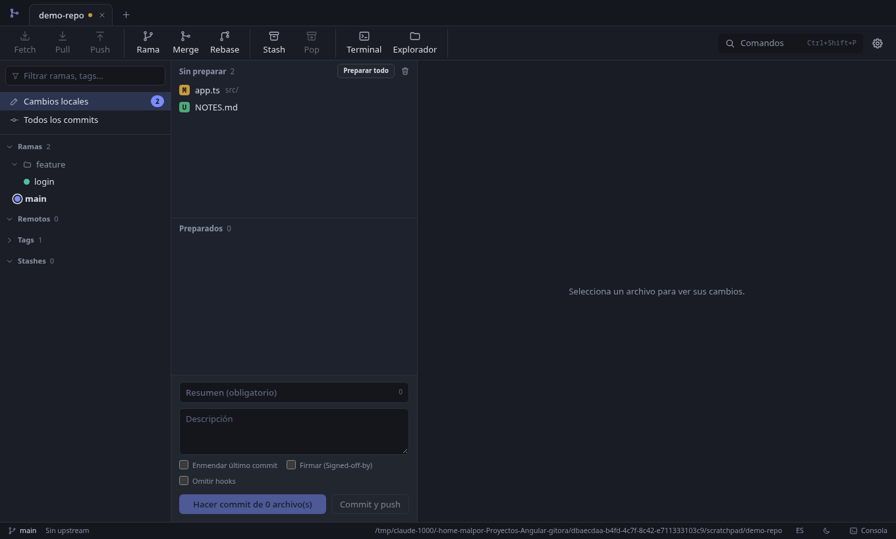

# Gitora

[English](README.en.md) | **Español**

Cliente Git gráfico para Windows y Linux. Usa el `git` instalado en tu sistema, así que tus hooks, llaves SSH, GPG y gestores de credenciales funcionan igual que en la terminal.



La documentación de uso, arquitectura y código está en [`docs/`](docs/README.md).

## Requisitos

- Git 2.30 o superior en el `PATH`.
- Para compilar desde las fuentes: Node.js 20 o superior y npm.
- Opcional: `git-lfs` (Git LFS) y `openssh` (remotos por SSH).

En Arch y derivados: `sudo pacman -S git`.

## Descargar

Los instaladores publicados están en [Releases](https://github.com/malpor23/gitora/releases). Si tu sistema no tiene uno, descarga el código y genera el instalador (ver más abajo).

```bash
git clone https://github.com/malpor23/gitora.git gitora
cd gitora
npm install
```

## Instalar

Genera el instalador con el comando de tu sistema. Los archivos quedan en la carpeta `release/`.

### Arch Linux y derivados

```bash
npm run dist:arch
sudo pacman -U release/gitora-0.1.0.pacman
```

También puedes usar el `PKGBUILD` incluido:

```bash
cd packaging/arch
makepkg -si
```

### Otras distribuciones Linux

```bash
npm run dist:linux
```

Genera `AppImage`, `.deb`, `.rpm` y `.tar.gz`. Con el AppImage basta darle permiso de ejecución:

```bash
chmod +x release/Gitora-*.AppImage
./release/Gitora-*.AppImage
```

### Windows

Ejecuta en Windows (no se puede generar desde Linux sin configuración adicional):

```bash
npm run dist:win
```

Genera un instalador NSIS (español e inglés) y una versión portable en `release/`.

## Ejecutar sin instalar

```bash
npm start
```

Compila el proceso principal, levanta Angular en modo desarrollo y abre Electron. Para probar la interfaz en el navegador, ver [docs/desarrollo.md](docs/desarrollo.md).

## Primeros pasos

1. Abre la aplicación y elige **Abrir repositorio local**, **Clonar repositorio** o **Crear repositorio nuevo**.
2. Para clonar repos privados por HTTPS agrega una cuenta en **Ajustes, Cuentas** (token, usuario y contraseña, clave SSH u OAuth).
3. Pulsa `Ctrl+Shift+P` para ver todos los comandos disponibles.

Guía completa: [docs/uso.md](docs/uso.md).

## Contribuir y soporte

- Errores y propuestas: [Issues](https://github.com/malpor23/gitora/issues).
- Aportes: lee [CONTRIBUTING.md](CONTRIBUTING.md) y abre un pull request.
- Vulnerabilidades: [SECURITY.md](SECURITY.md).

## Licencia

MIT. Ver [LICENSE](LICENSE).
