# Usage guide

## Start screen

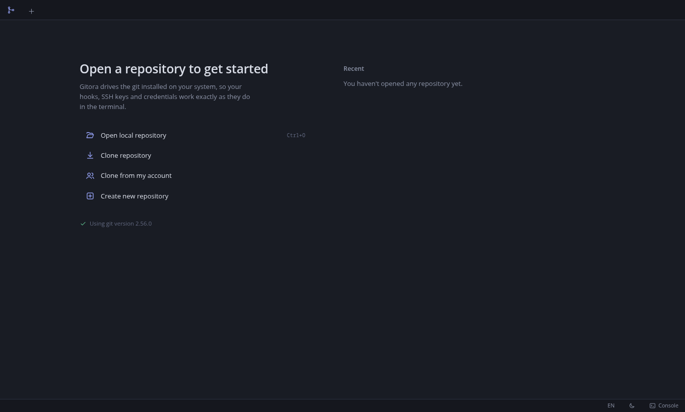

- **Open local repository** (`Ctrl+O`): pick a folder that is already a git repository.
- **Clone repository**: URL, destination folder, branch, depth (`--depth`), submodules and `--bare`. Shows clone progress.
- **Clone from my account**: lists the repositories of your configured accounts (GitHub, GitLab, Bitbucket, Gitea).
- **Create new repository**: runs `git init`, with an optional initial branch.

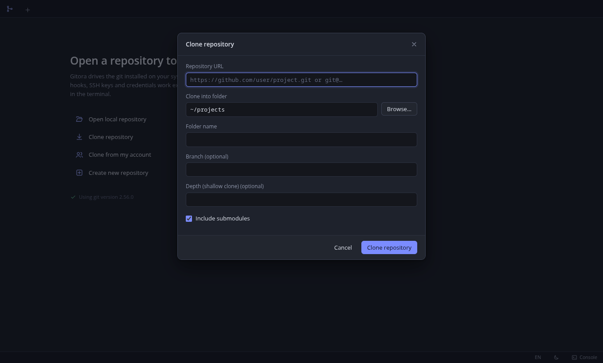

For private repositories over HTTPS, add an account first (see [Accounts](#accounts)). Without an account git cannot ask for credentials and the clone fails with a message that says so.

## Local changes and commit

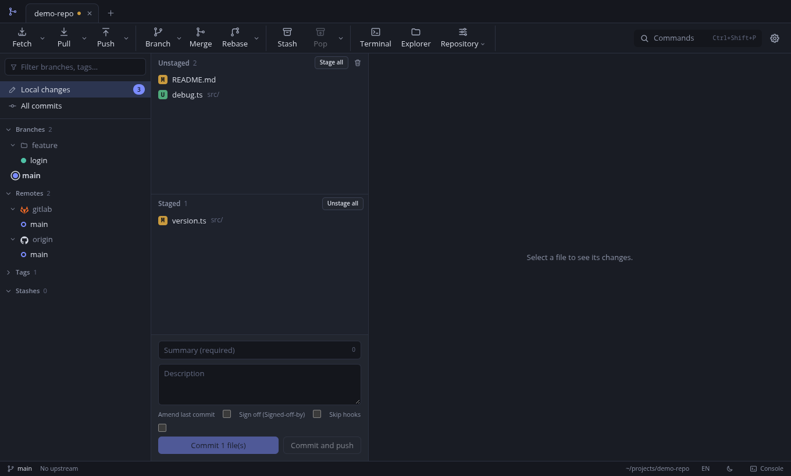

Remote shortcuts: `Ctrl+Shift+F` (fetch), `Ctrl+Shift+L` (quick pull) and `Ctrl+Shift+K` (quick push) do the same as the toolbar buttons; the dialog versions "Pull…" and "Push…" are in the palette and on the button's right click.

Central panel: **unstaged** and **staged** files. You can stage or unstage per file, per hunk and per line (click the `+`/`-` lines in the diff, `Shift` extends the selection). Below it, the commit form: summary, description, amend, sign-off (`Signed-off-by`) and skip hooks.

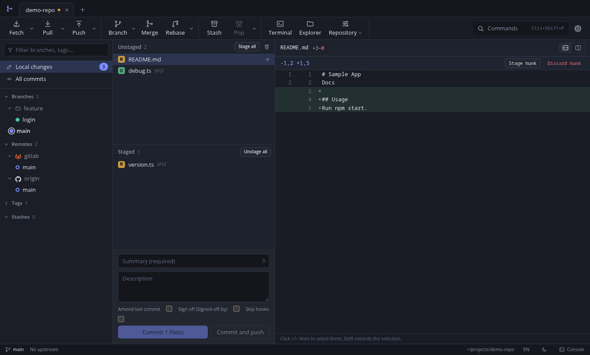

The diff supports unified and side-by-side views. Hunks can also be discarded from here.

### Images

Images (PNG, JPEG, GIF, WebP, AVIF, BMP and ICO) do not show the "binary file" notice: the viewer shows the old and new versions with their dimensions and size, over a checkerboard background so transparency is visible. There are three modes:

- **Side by side**: both versions next to each other.
- **Slider**: both overlaid; the control splits the image between "Before" and "After".
- **Blend**: the new version over the old one with adjustable opacity.

It works in Changes (unstaged against the index, staged against `HEAD`) and in the history (the commit against its first parent). If the file is new or deleted, only the existing version is shown. Images over 10 MB are not shown; SVG files appear as text.

### Conventional commit types

The tag button, to the left of the summary, opens a menu with the [Conventional Commits](https://www.conventionalcommits.org/) types (`feat`, `fix`, `docs`, `style`, `refactor`, `perf`, `test`, `build`, `ci`, `chore` and `revert`). Choosing one writes `type: ` at the start of the summary; if the summary already started with a known type it is replaced, keeping the scope and the `!` mark (`feat(ui)!: x` becomes `fix(ui)!: x`). **Breaking change (!)** adds or removes that mark. A summary that starts with another word and a colon (`Note: ...`) is not mistaken for a type.

**Customize types…** saves a list of your own for that repository, separated by commas, in its local git config (`gitora.commitTypes`); leaving it empty restores the default types.

### Co-authors

Below the commit description there is a **Co-authors** field. Type `Name <email>` and press Enter to add it as a chip (the **×** removes it); recent authors of the repository appear as suggestions while you type. When you commit, one `Co-authored-by: Name <email>` line per co-author is added to the message, next to the `Signed-off-by` if you ticked it, and GitHub and GitLab recognise them. Whatever is typed in the field counts even without pressing Enter; if the format is not valid you are warned and no commit is made. When amending, co-authors the message already had are not repeated. The chips are cleared after each commit.

## History

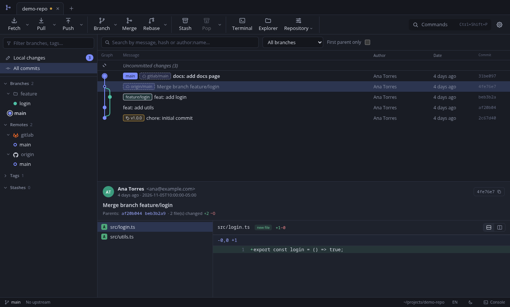

Commit graph with a colored lane per branch, search by message, hash or author (type `author:name`), branch filter, first parent only and progressive loading. Selecting a commit shows its details and files. From a commit's context menu: cherry-pick, revert, reset, create branch or tag, interactive rebase.

### Issue links

In a commit's details, issue references in the summary and description are links that open in the browser. For GitHub, GitLab, Codeberg and Bitbucket repositories the rule is derived from the `origin` remote (`#123` opens `.../issues/123`). For another server, or for Jira keys, it is set in the repository's local config (**More → git config**, local scope):

| Key | Value |
|-----|-------|
| `gitora.issueUrl` | URL containing `{id}`, for example `https://jira.company.com/browse/{id}` (`http` or `https` only) |
| `gitora.issuePattern` | `number` for `#123` (default) or `key` for `ABC-123` |

Only those two reference forms exist, on purpose: custom regular expressions are not accepted. A lone `#`, a colour such as `#fff` or a number glued to a word is not linked.

## Toolbar

The most used actions sit below the tabs. Buttons with an arrow (chevron) open a dropdown menu:

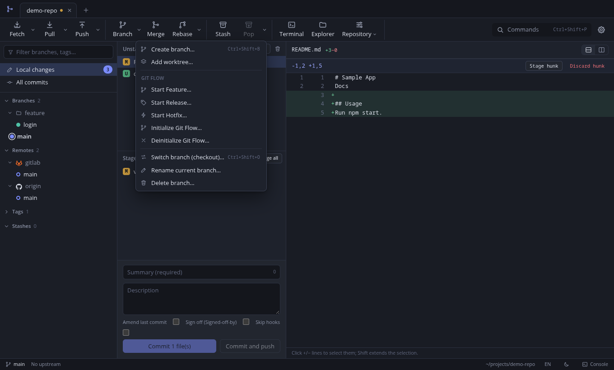

| Button | Main click | Dropdown |
|--------|------------|----------|
| Fetch | Quick fetch | Fetch (choose remote), Fetch all |
| Pull | Quick pull | Pull dialog (remote, branch, rebase, autostash) |
| Push | Quick push | Push dialog, Force push, Push all tags |
| Branch | New branch | New worktree, Git Flow (feature, release, hotfix, init, deinit), checkout, rename, delete |
| Rebase | Rebase | Interactive rebase, cherry-pick, revert, reset, continue, skip, abort |
| Pop | Apply the latest stash | Save stash, pop, clear |
| Repository | (dropdown only) | Refresh, new tag, apply patch, bisect, reflog, statistics, treemap, benchmark, gc, archive, identity and configuration |

Options that do not apply to the current state (for example, continue with no operation in progress) are not shown.

## Command palette

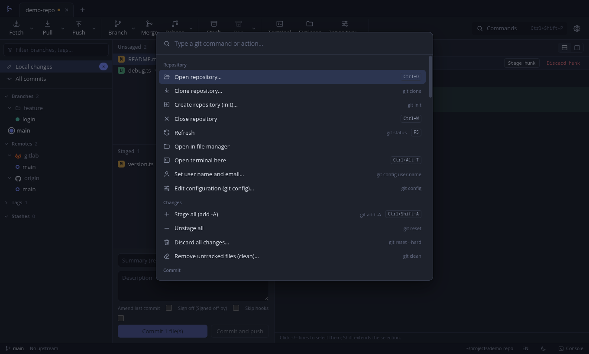

`Ctrl+Shift+P` lists every git command with its shortcut. It is the fastest way to reach less frequent features (bisect, worktrees, submodules, LFS, `gc`, archive, patches).

## Console

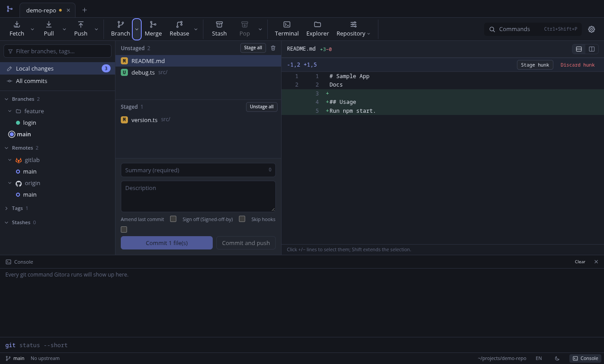

`` Ctrl+` `` opens the console. Every command Gitora runs is logged with its output and duration. You can also type your own git commands (with or without the `git` prefix). Commands that would open an editor (for example `rebase -i`) use a non-interactive editor that accepts the default content; to build the rebase, use the visual interactive rebase.

## Settings

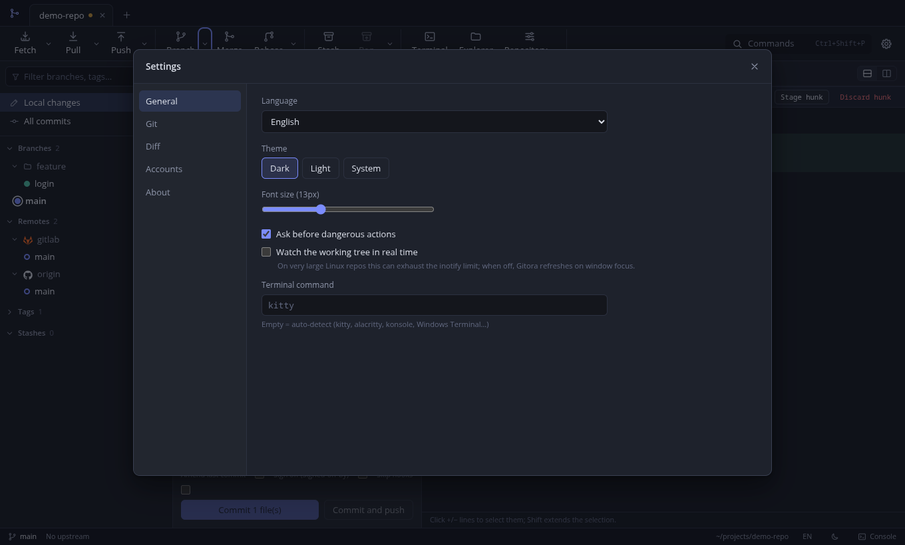

Language (Spanish, English, Brazilian Portuguese, French or German, live), theme (dark, light, system), font size, confirmation for dangerous actions, working directory watching, preferred terminal, and the Git, Diff, Accounts and About tabs. The side panel width and the console height (drag their edge) are remembered between sessions.

## Accounts

In **Settings, Accounts** you manage your GitHub (and Enterprise), GitLab (and self-hosted), Bitbucket and Gitea/Forgejo/Codeberg accounts. The left side lists each account with its logo, platform and username (use the arrow keys to move); the right side shows the selected one. Below the list, **+** adds an account and **-** removes it (it asks for confirmation; it only deletes the credential stored in Gitora, nothing at the provider).

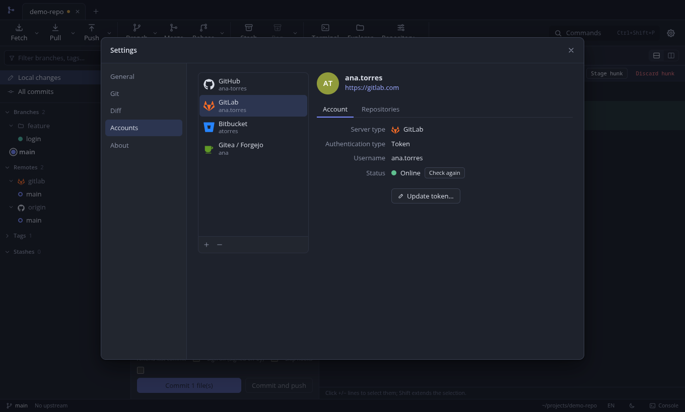

The detail shows the avatar (or initials), the username and the server as a link (opened in the system browser), and two tabs:

- **Account**: server type, authentication type, username, the key path for SSH accounts and the **Status**. When you select the account its credential is checked against the provider (8 seconds at most): *Online*, *Offline*, *Invalid credential* or *Cannot be verified* (SSH keys and accounts without API access, which are not queried). **Check again** repeats the check. The button below depends on the method: **Update token...**, **Update password...**, **Change key...** or **Authorize again...**.
- **Repositories**: **Clone from this account...** opens the repository list of that account so you can clone one. If the account has no API access, the tab explains it.

To **add** an account click **+** (or **Add account** when there are none yet) and choose the platform in the grid: Bitbucket, Gitea / Forgejo, GitHub, GitHub Enterprise, GitLab or GitLab (self-hosted). Enterprise and self-hosted require the server. Then fill in the form (**Back** returns to the grid).

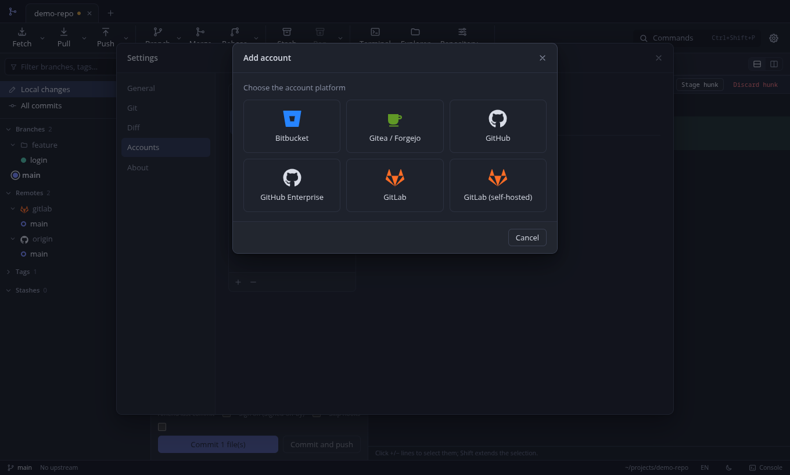

Each account is shown with its platform logo. The same logo appears next to each remote in the **Remotes** section of the side panel (for example GitLab next to `gitlab` and GitHub next to `origin`); it is recognized from your configured accounts and, failing that, from the server name. If it is not recognized, a cloud is shown.

To **change the credential** (for example, when the token expired or was deleted, or the SSH key path changed), click the button on the **Account** tab (**Update token...**, etc.): the dialog opens in edit mode and you only need to type the new credential (the current value is never shown) and **Save changes**. With OAuth you authorize again. In the same dialog you can **change the authentication method** (for example, from token to SSH key): the account is replaced by the new one, with no duplicates. The provider, server and user are fixed; to change them, remove the account and add it again.

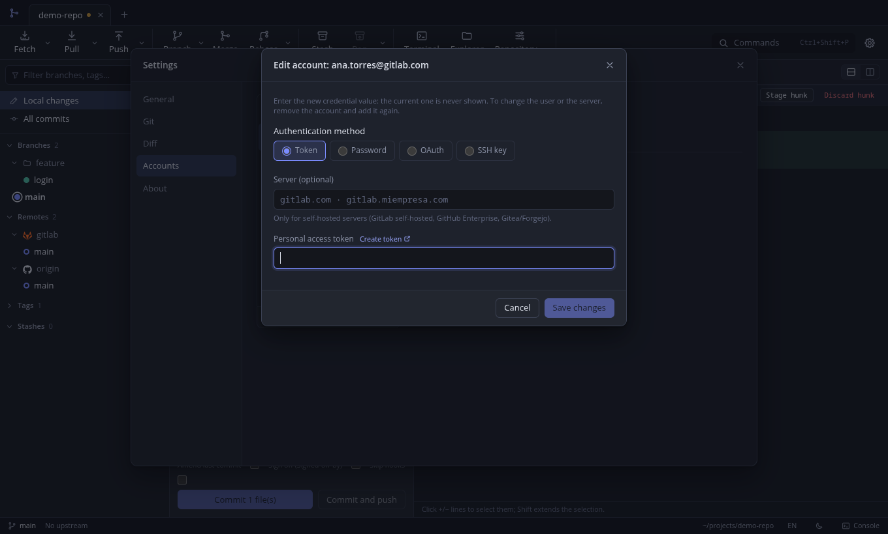

Authentication methods, depending on the provider:

| Method | Use |
|--------|-----|
| Access token | HTTPS and API (clone from account, pull requests) |
| Username and password | HTTPS; on Bitbucket, an App Password |
| SSH key | SSH remotes of that server, no API access |
| OAuth (device flow) | GitHub and GitLab, with the Client ID of your own OAuth App |

Recommended token permissions:

- **GitHub:** `repo` (and `read:org` if you use organizations).
- **GitLab:** `api`, `read_repository`, `write_repository`.
- **Bitbucket:** username and App Password.
- **Gitea, Forgejo, Codeberg:** application token.

Leave the **Server** field empty for `github.com`, `gitlab.com` and `bitbucket.org`. For self-hosted servers, type the domain (`gitlab.mycompany.com`); Gitora completes the API path.

Secrets are encrypted with the system keyring and never reach the interface.

## Keyboard shortcuts

| Shortcut | Action |
|----------|--------|
| `Ctrl+Shift+P` | Command palette |
| `Ctrl+O` | Open repository |
| `F5` | Refresh |
| `↑` `↓` `Home` `End` | In the Changes file lists: move the selection |
| `Enter` or `Space` | In the file lists: stage, unstage or resolve the conflict |
| `Delete` | With focus on a repository tab: close it |
| `Ctrl+1` / `Ctrl+2` | Local changes / History |
| `Ctrl+Shift+F` / `L` / `K` | Fetch / Pull / Push |
| `Ctrl+Shift+B` | Create branch |
| `Ctrl+Shift+O` | Switch branch |
| `Ctrl+Shift+M` | Merge |
| `Ctrl+Shift+S` | Stash |
| `Ctrl+Shift+A` | Stage all |
| `Ctrl+Shift+G` | Custom git command |
| `Ctrl+Enter` / `Ctrl+Shift+Enter` | Commit / Commit and push |
| `Ctrl+F` | Search commits |
| `` Ctrl+` `` | Console |
| `Ctrl+,` | Settings |

## Features by area

| Area | Features |
|------|----------|
| Repositories | Open, clone, create, tabs, recent, terminal and file explorer |
| Changes | Stage per file, hunk and line; discard; ignore; `clean` with preview; image diff (side by side, slider and blend) |
| Commit | Summary and description, conventional commit types, co-authors, amend, sign-off, skip hooks, commit and push |
| History | Graph, search, file history, blame |
| Branches | Create, checkout, rename, delete (local and remote), upstream |
| Integration | Merge (ff, no-ff, ff-only, squash), rebase, visual interactive rebase, cherry-pick, revert, reset |
| Conflicts | Block-by-block resolution, result editing, external `mergetool` |
| Remotes | Fetch, pull (merge, rebase, ff-only, autostash), push (upstream, tags, force-with-lease), manage remotes |
| Tags and stash | Lightweight and annotated, remote push and delete; stash with options |
| More | Submodules, worktrees, bisect, reflog, `git config`, Git LFS, `gc`, `archive`, patches, git flow, repository statistics |
