# Guía de uso

## Pantalla de inicio

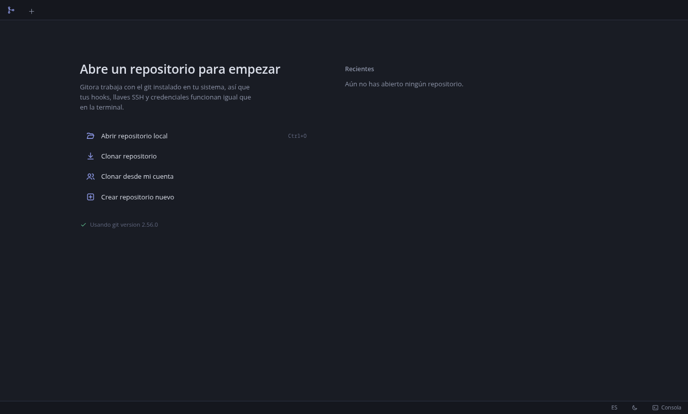

- **Abrir repositorio local** (`Ctrl+O`): elige una carpeta que ya sea un repositorio git.
- **Clonar repositorio**: URL, carpeta destino, rama, profundidad (`--depth`), submódulos y `--bare`. Muestra el progreso del clone.
- **Clonar desde mi cuenta**: lista los repositorios de las cuentas configuradas (GitHub, GitLab, Bitbucket, Gitea).
- **Crear repositorio nuevo**: ejecuta `git init`, con rama inicial opcional.

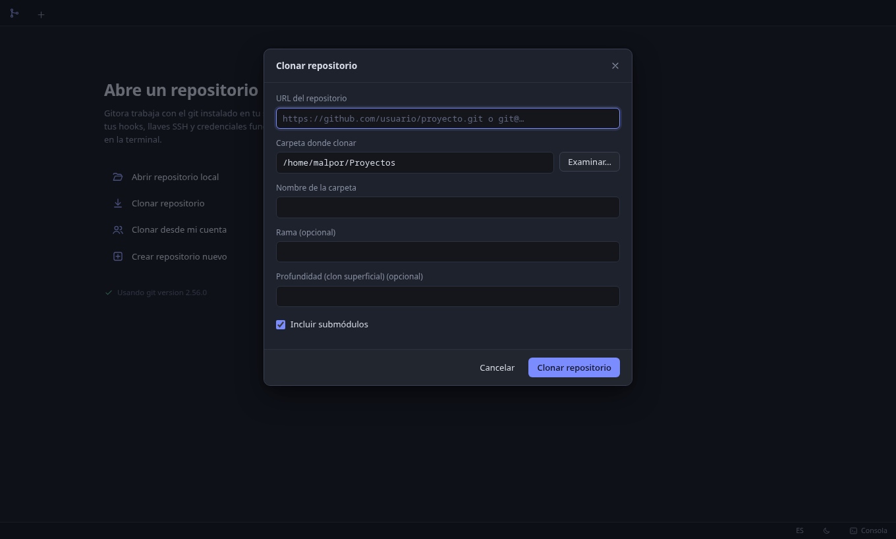

Para repositorios privados por HTTPS, agrega antes una cuenta (ver [Cuentas](#cuentas)). Sin cuenta, git no puede pedir credenciales y el clone falla con un mensaje que lo indica.

## Cambios locales y commit

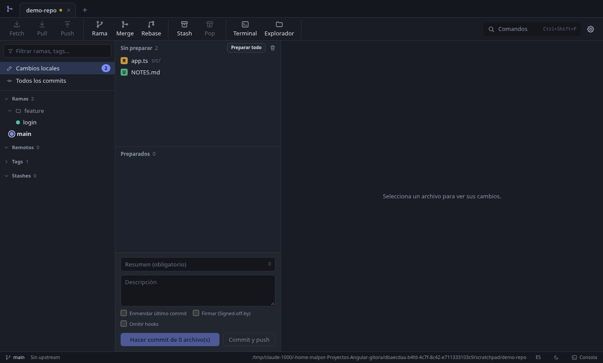

Atajos de remoto: `Ctrl+Shift+F` (fetch), `Ctrl+Shift+L` (pull rápido) y `Ctrl+Shift+K` (push rápido) hacen lo mismo que los botones de la barra; «Pull…» y «Push…» con diálogo están en la paleta y en el clic derecho del botón.

Panel central: archivos **sin preparar** y **preparados**. Se pueden preparar o quitar por archivo, por hunk y por línea (clic en las líneas `+`/`-` del diff, `Mayús` amplía la selección). Debajo, el formulario de commit: resumen, descripción, enmendar, firmar (`Signed-off-by`) y omitir hooks.

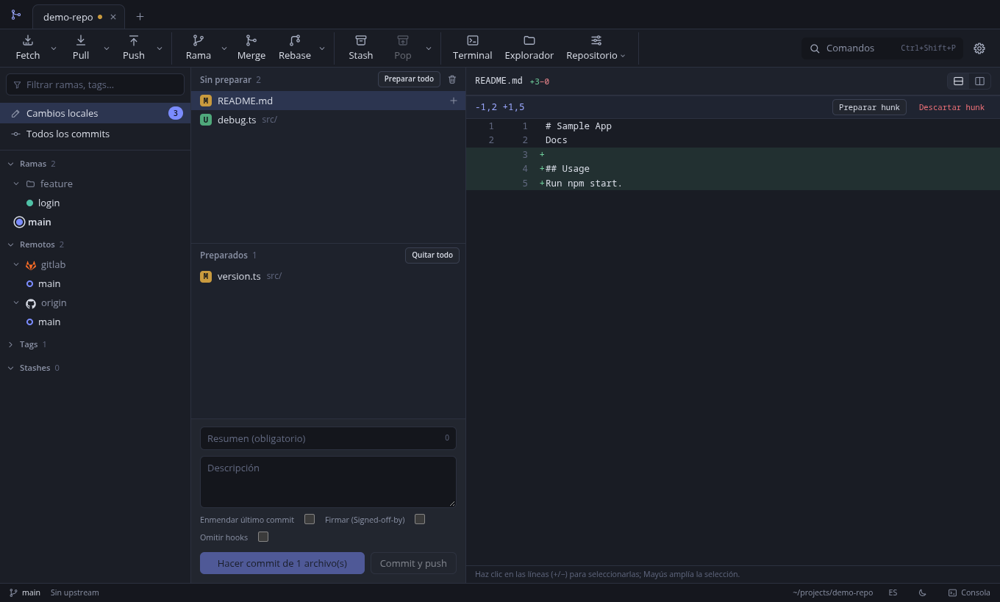

El diff admite vista unificada y en paralelo. Desde aquí también se descartan hunks.

### Imágenes

Las imágenes (PNG, JPEG, GIF, WebP, AVIF, BMP e ICO) no muestran el aviso de «archivo binario»: el visor enseña la versión anterior y la nueva, con sus dimensiones y su peso, sobre un fondo de tablero para ver la transparencia. Hay tres modos:

- **Lado a lado**: las dos versiones una junto a la otra.
- **Deslizador**: las dos superpuestas; el control reparte la imagen entre «Antes» y «Después».
- **Mezcla**: la nueva sobre la anterior con opacidad ajustable.

Funciona en Cambios (sin preparar contra el índice, preparados contra `HEAD`) y en el historial (el commit contra su primer padre). Si el archivo es nuevo o fue eliminado solo se muestra la versión que existe. No se muestran imágenes de más de 10 MB; los SVG se ven como texto.

### Tipos de commit convencionales

El botón de la etiqueta, a la izquierda del resumen, abre un menú con los tipos de [Conventional Commits](https://www.conventionalcommits.org/es/) (`feat`, `fix`, `docs`, `style`, `refactor`, `perf`, `test`, `build`, `ci`, `chore` y `revert`). Al elegir uno se escribe `tipo: ` al inicio del resumen; si el resumen ya empezaba con un tipo conocido se reemplaza y se conservan el alcance y la marca `!` (`feat(ui)!: x` pasa a `fix(ui)!: x`). **Cambio incompatible (!)** añade o quita esa marca. Un resumen que empieza con otra palabra y dos puntos (`Nota: ...`) no se toma por un tipo.

**Personalizar tipos…** guarda una lista propia para ese repositorio, separada por comas, en su configuración local de git (`gitora.commitTypes`); dejarla vacía restaura los tipos predeterminados.

### Co-autores

Bajo la descripción del commit hay un campo **Co-autores**. Escribe `Nombre <correo>` y pulsa Enter para añadirlo como chip (con la **×** se quita); al escribir aparecen como sugerencia los autores recientes del repositorio. Al hacer el commit se añade al mensaje una línea `Co-authored-by: Nombre <correo>` por cada co-autor, junto al `Signed-off-by` si lo marcaste, y GitHub y GitLab los reconocen. Lo escrito en el campo cuenta aunque no pulses Enter; si el formato no es válido se avisa y no se hace el commit. Al enmendar no se repiten los co-autores que el mensaje ya tenía. Los chips se vacían tras cada commit.

## Historial

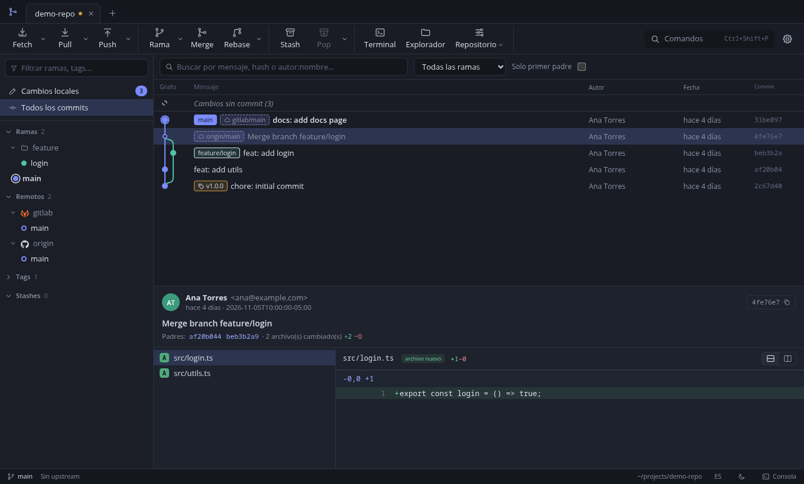

Grafo de commits con carriles de color por rama, búsqueda por mensaje, hash o autor (escribe `autor:nombre`), filtro por rama, primer padre y carga progresiva. Al elegir un commit se ven sus detalles y archivos. Desde el menú contextual de un commit: cherry-pick, revert, reset, crear rama o tag, rebase interactivo.

### Enlaces a issues

En el detalle de un commit, las referencias a issues del resumen y de la descripción son enlaces que se abren en el navegador. Para repositorios de GitHub, GitLab, Codeberg y Bitbucket la regla se deduce del remoto `origin` (`#123` abre `.../issues/123`). Para otro servidor, o para claves de Jira, se define en la configuración local del repositorio (**Más → git config**, ámbito local):

| Clave | Valor |
|-------|-------|
| `gitora.issueUrl` | Dirección con `{id}`, por ejemplo `https://jira.empresa.com/browse/{id}` (solo `http` o `https`) |
| `gitora.issuePattern` | `number` para `#123` (por omisión) o `key` para `ABC-123` |

Solo existen esas dos formas de referencia, a propósito: no se aceptan expresiones regulares propias. Un `#` suelto, un color como `#fff` o un número pegado a una palabra no se enlazan.

## Barra de herramientas

Debajo de las pestañas están las acciones más usadas. Los botones con una flecha (chevron) abren un menú desplegable:

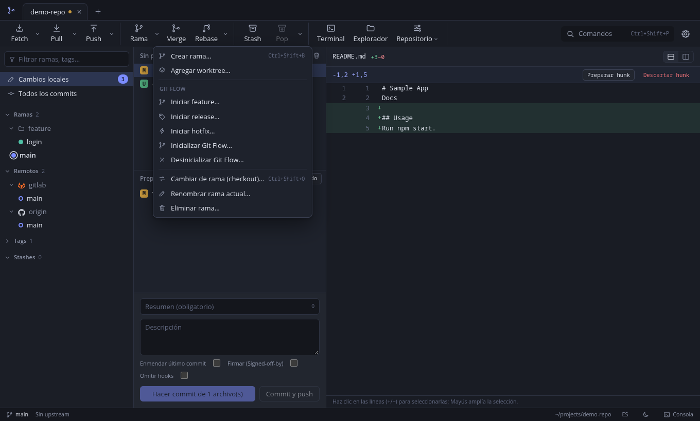

| Botón | Clic principal | Desplegable |
|-------|----------------|-------------|
| Fetch | Fetch rápido | Fetch (elegir remoto), Fetch all |
| Pull | Pull rápido | Pull con diálogo (remoto, rama, rebase, autostash) |
| Push | Push rápido | Push con diálogo, Force push, Push all tags |
| Branch | Nueva rama | Nuevo worktree, Git Flow (feature, release, hotfix, init, deinit), checkout, renombrar, eliminar |
| Rebase | Rebase | Rebase interactivo, cherry-pick, revert, reset, continuar, omitir, abortar |
| Pop | Aplicar el último stash | Guardar stash, pop, vaciar |
| Repository | (solo desplegable) | Refresh, nuevo tag, aplicar parche, bisect, reflog, estadísticas, treemap, benchmark, gc, archivo, identidad y configuración |

Las opciones que no aplican al estado actual (por ejemplo, continuar sin una operación en curso) no aparecen.

## Paleta de comandos

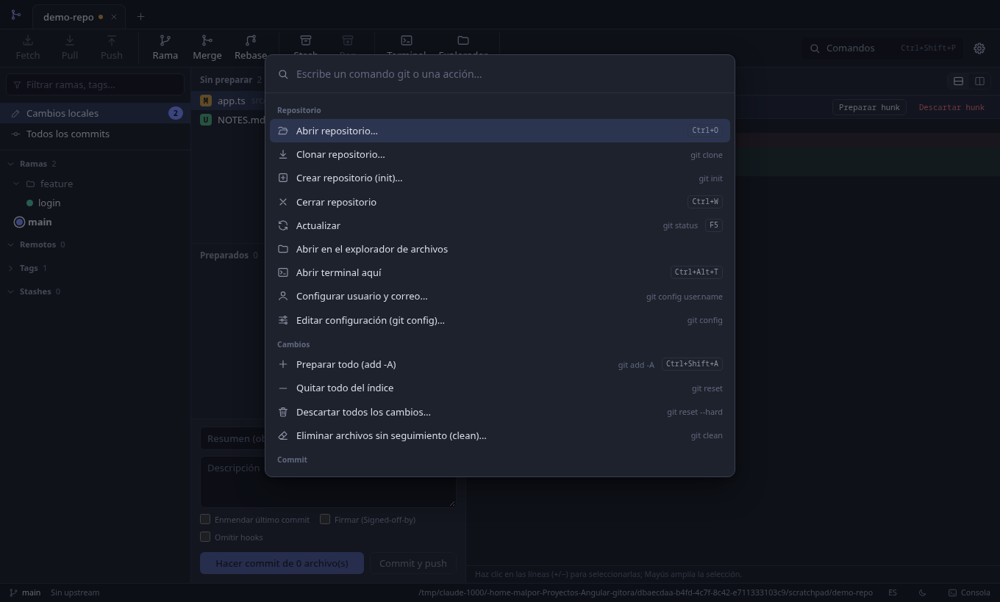

`Ctrl+Shift+P` lista todos los comandos git con su atajo. Es la forma más rápida de llegar a funciones menos frecuentes (bisect, worktrees, submódulos, LFS, `gc`, archivo, parches).

## Consola

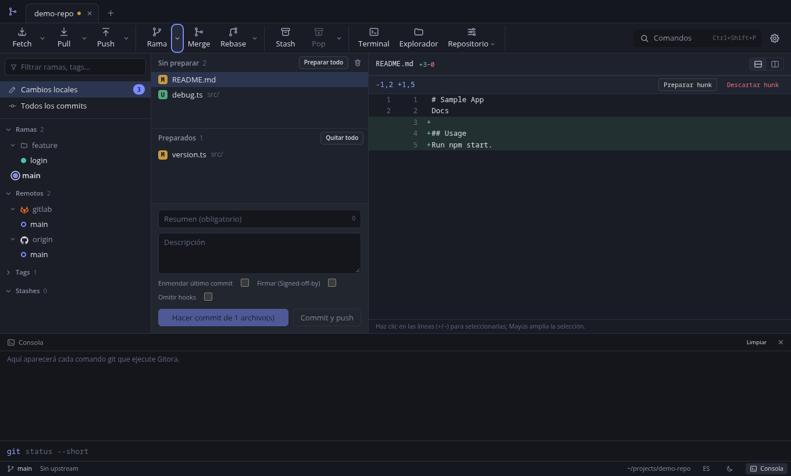

`` Ctrl+` `` abre la consola. Cada comando que ejecuta Gitora queda registrado con su salida y duración. También puedes escribir comandos git propios (sin el prefijo `git`, o con él). Los comandos que abrirían un editor (por ejemplo `rebase -i`) usan un editor no interactivo que acepta el contenido por defecto; para armar el rebase usa el rebase interactivo visual.

## Ajustes

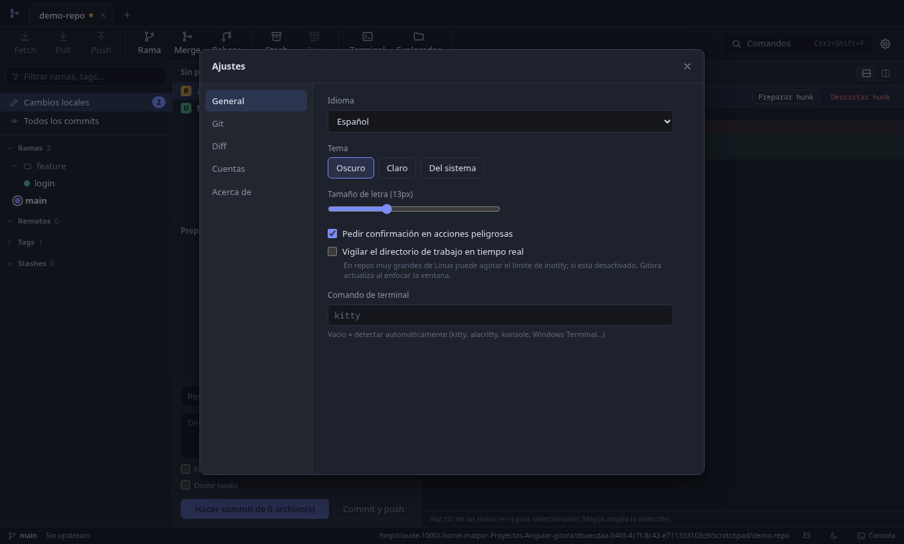

Idioma (español o inglés, en vivo), tema (oscuro, claro, del sistema), tamaño de letra, confirmación en acciones peligrosas, vigilancia del directorio de trabajo, terminal preferida, y las pestañas Git, Diff, Cuentas y Acerca de. El ancho del panel lateral y el alto de la consola (se arrastran desde su borde) se recuerdan entre sesiones.

## Cuentas

En **Ajustes, Cuentas** se administran las cuentas de GitHub (y Enterprise), GitLab (y propio), Bitbucket y Gitea/Forgejo/Codeberg. A la izquierda hay una lista con el logo, la plataforma y el usuario de cada cuenta (se navega con las flechas); a la derecha, el detalle de la seleccionada. Debajo de la lista, **+** agrega una cuenta y **-** la quita (pide confirmación; solo borra la credencial guardada en Gitora, nada en el proveedor).

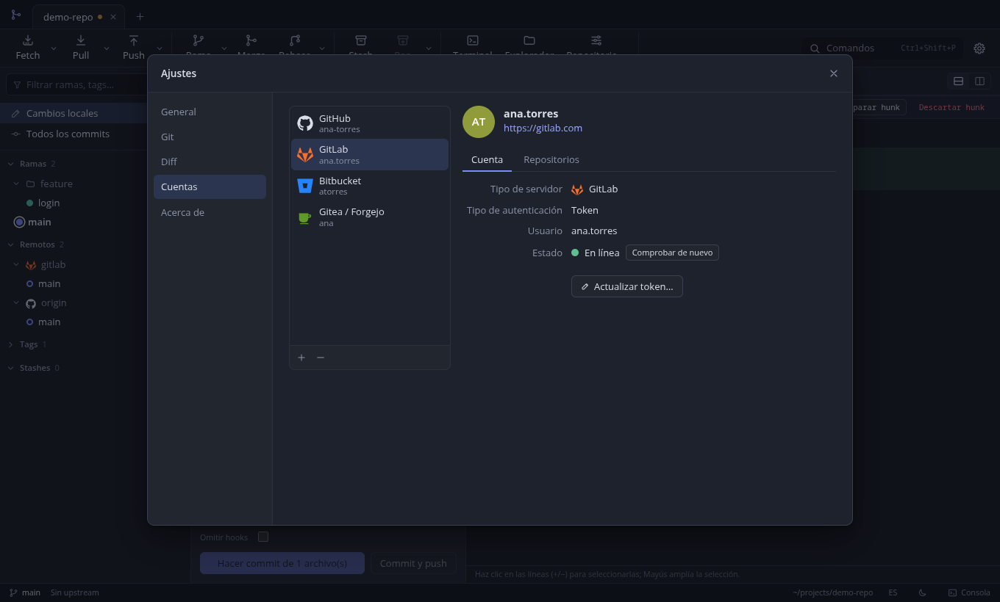

El detalle muestra el avatar (o las iniciales), el usuario y el servidor como enlace (se abre en el navegador del sistema), y dos pestañas:

- **Cuenta**: tipo de servidor, tipo de autenticación, usuario, la ruta de la clave en las cuentas SSH y el **Estado**. Al seleccionar la cuenta se comprueba la credencial contra el proveedor (máximo 8 segundos): *En línea*, *Sin conexión*, *Credencial inválida* o *No verificable* (claves SSH y cuentas sin acceso a la API, que no se consultan). **Comprobar de nuevo** repite la comprobación. El botón de abajo cambia según el método: **Actualizar token...**, **Actualizar contraseña...**, **Cambiar clave...** o **Volver a autorizar...**.
- **Repositorios**: **Clonar desde esta cuenta...** abre la lista de repositorios de esa cuenta para clonar uno. Si la cuenta no tiene acceso a la API, la pestaña lo explica.

Para **agregar** una cuenta pulsa **+** (o **Agregar cuenta** si aún no hay ninguna) y elige la plataforma en la cuadrícula: Bitbucket, Gitea / Forgejo, GitHub, GitHub Enterprise, GitLab o GitLab (propio). Enterprise y propio exigen indicar el servidor. Después se rellena el formulario (**Atrás** vuelve a la cuadrícula).

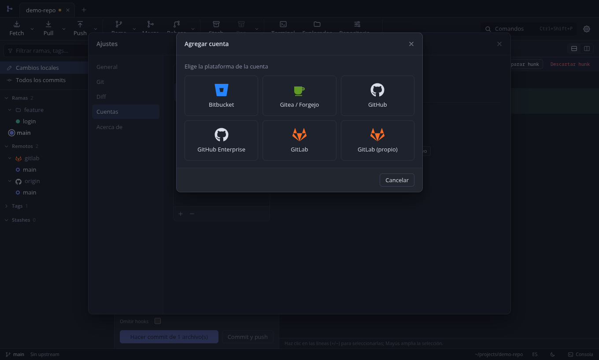

Cada cuenta se muestra con el logo de su plataforma. Ese mismo logo aparece junto a cada remoto en la sección **Remotos** del panel lateral (por ejemplo, GitLab junto a `gitlab` y GitHub junto a `origin`); se reconoce por tus cuentas configuradas y, si no hay una, por el nombre del servidor. Si no se reconoce, se muestra una nube.

Para **cambiar la credencial** (por ejemplo, si el token venció o lo eliminaron, o si cambió la ruta de la clave SSH), pulsa el botón de la pestaña **Cuenta** (**Actualizar token...**, etc.): el diálogo se abre en modo edición y solo hay que escribir la credencial nueva (el valor actual nunca se muestra) y **Guardar cambios**. Con OAuth se vuelve a autorizar. En el mismo diálogo puedes **cambiar el método de autenticación** (por ejemplo, de token a clave SSH): la cuenta se reemplaza por la nueva, sin duplicados. El proveedor, el servidor y el usuario quedan fijos; para cambiarlos, quita la cuenta y agrégala de nuevo.

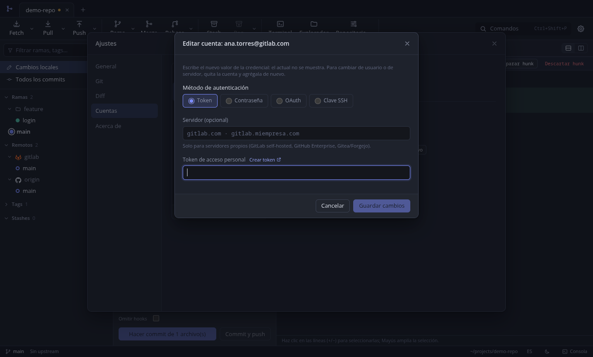

Métodos de autenticación, según el proveedor:

| Método | Uso |
|--------|-----|
| Token de acceso | HTTPS y API (clonar desde cuenta, pull requests) |
| Usuario y contraseña | HTTPS; en Bitbucket, App Password |
| Clave SSH | Remotos SSH de ese servidor, sin acceso a la API |
| OAuth (device flow) | GitHub y GitLab, con el Client ID de tu propia OAuth App |

Permisos de token recomendados:

- **GitHub:** `repo` (y `read:org` si usas organizaciones).
- **GitLab:** `api`, `read_repository`, `write_repository`.
- **Bitbucket:** usuario y App Password.
- **Gitea, Forgejo, Codeberg:** token de aplicación.

En el campo **Servidor** deja vacío para `github.com`, `gitlab.com` y `bitbucket.org`. Para servidores propios escribe el dominio (`gitlab.miempresa.com`); Gitora completa la ruta de la API.

Los secretos se cifran con el llavero del sistema y no llegan a la interfaz.

## Atajos de teclado

| Atajo | Acción |
|-------|--------|
| `Ctrl+Shift+P` | Paleta de comandos |
| `Ctrl+O` | Abrir repositorio |
| `F5` | Actualizar |
| `↑` `↓` `Inicio` `Fin` | En las listas de archivos de Cambios: mover la selección |
| `Enter` o `Espacio` | En las listas de archivos: preparar, quitar de lo preparado o resolver el conflicto |
| `Supr` | Con el foco en una pestaña de repositorio: cerrarla |
| `Ctrl+1` / `Ctrl+2` | Cambios locales / Historial |
| `Ctrl+Shift+F` / `L` / `K` | Fetch / Pull / Push |
| `Ctrl+Shift+B` | Crear rama |
| `Ctrl+Shift+O` | Cambiar de rama |
| `Ctrl+Shift+M` | Merge |
| `Ctrl+Shift+S` | Stash |
| `Ctrl+Shift+A` | Preparar todo |
| `Ctrl+Shift+G` | Comando git personalizado |
| `Ctrl+Enter` / `Ctrl+Shift+Enter` | Commit / Commit y push |
| `Ctrl+F` | Buscar commits |
| `` Ctrl+` `` | Consola |
| `Ctrl+,` | Ajustes |

## Funciones por área

| Área | Funciones |
|------|-----------|
| Repositorios | Abrir, clonar, crear, pestañas, recientes, terminal y explorador |
| Cambios | Stage por archivo, hunk y línea; descartar; ignorar; `clean` con vista previa; diff de imágenes (lado a lado, deslizador y mezcla) |
| Commit | Resumen y descripción, tipos de commit convencionales, co-autores, enmendar, sign-off, omitir hooks, commit y push |
| Historial | Grafo, búsqueda, historial de archivo, blame |
| Ramas | Crear, checkout, renombrar, eliminar (local y remota), upstream |
| Integración | Merge (ff, no-ff, ff-only, squash), rebase, rebase interactivo visual, cherry-pick, revert, reset |
| Conflictos | Resolución por bloques, edición del resultado, `mergetool` externo |
| Remotos | Fetch, pull (merge, rebase, ff-only, autostash), push (upstream, tags, force-with-lease), administrar remotos |
| Tags y stash | Ligeros y anotados, push y borrado remoto; stash con opciones |
| Más | Submódulos, worktrees, bisect, reflog, `git config`, Git LFS, `gc`, `archive`, parches, git flow, estadísticas del repositorio |
